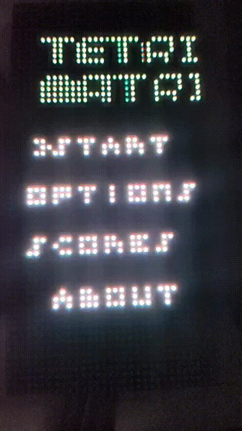

# tetrismatrix

a Tetris game for the Raspberry Pi Pico WH, displayed on a HUB75 64x32 LED matrix.
<p align="center">

</p>

## Running
to run this, you'll (obviously) need a Raspberry Pi Pico WH and a HUB75 64x32 LED matrix panel, and any controller supported by the [Bluepad32 library](https://github.com/ricardoquesada/bluepad32).
the panel I've tested this on is [this Waveshare one](https://docs.waveshare.com/RGB-Matrix-Px-64x32).

in the model of panel mentioned before, the pin layout is the next one:

<p align="center">

</p>

and it should be connected like this to the Pico:

<p align="center">

</p>
you'd also need to supply power to the panel itself, which in the Waveshare panel it's 5V.

then, you can either clone the repo:
```bash
git clone --recurse-submodules https://github.com/notsomealex/tetrismatrix.git
```
and I'd recommend opening it in VSCode and installing the **Raspberry Pi Pico** extension. then it's just as straightforward as compiling and loading into the Pico with it.

or, you can download the .**uf2** file from Releases and just copy it into your Pico while it's in BOOTSEL mode.
if you're on Linux, for example:
```bash
 cp tetrismatrix.uf2 /run/media/$USER/RPI-RP2/
```
and it should restart and the game should start playing!

## Playing

when you first start the game, it will look for controllers. you'll need to pair any controller supported by [Bluepad32](https://github.com/ricardoquesada/bluepad32).
then, you'll be in the main menu!

you can:
* play any of the single-player gamemodes **(Zen, Marathon)**.
* play any of the two-player gamemodes **(Versus, Coop)**.
* connect to the Internet and (if the servers are working) check the highest scores, as well as submit scores!
* change the language between English and Spanish.

## Pictures


## Credits

[the Pico SDK](https://github.com/raspberrypi/pico-sdk).
[the Pimoroni libraries for the Raspberry Pi Pico](https://github.com/pimoroni/pimoroni-pico).
[Bluepad32](https://github.com/ricardoquesada/bluepad32).

